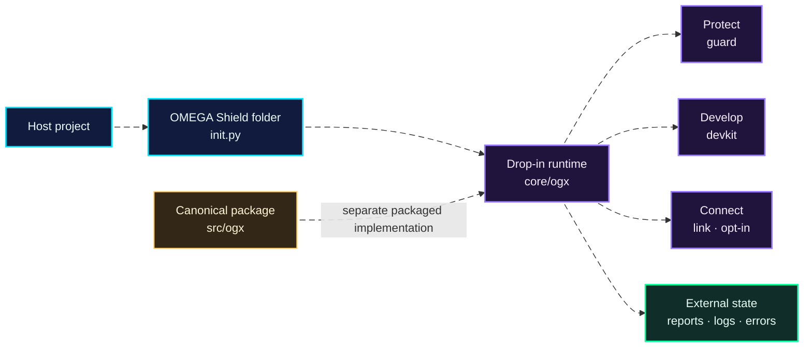
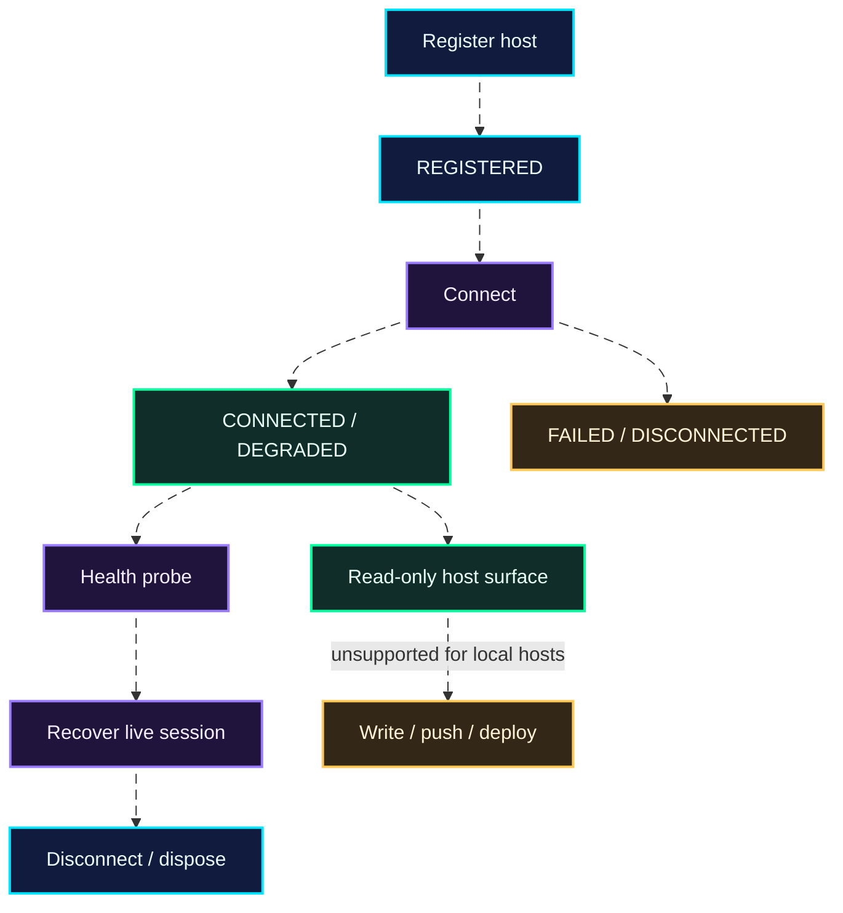

<a id="readme-top"></a>

<div align="center">

<a href="https://github.com/shajeduzzamanenan992008inc/OMEGA-GUARDIAN-X-Universal">
  
</a>

<h1>OMEGA Shield (OGX)</h1>

<p>
  <strong>Universal Plug-and-Play Shield &amp; Developer Core</strong><br>
  Portable repository protection · Engineering intelligence · Governed integrations
</p>

<p><em>One folder. One entry point. A bounded, local-first engineering toolkit.</em></p>

<p>
  <a href="#overview"><strong>Overview</strong></a> &nbsp;·&nbsp;
  <a href="#capabilities"><strong>Capabilities</strong></a> &nbsp;·&nbsp;
  <a href="#architecture"><strong>Architecture</strong></a> &nbsp;·&nbsp;
  <a href="#quick-start"><strong>Quick Start</strong></a> &nbsp;·&nbsp;
  <a href="#host-and-provider-engine"><strong>Hosts &amp; Providers</strong></a> &nbsp;·&nbsp;
  <a href="#security-model"><strong>Security</strong></a> &nbsp;·&nbsp;
  <a href="#verification"><strong>Verification</strong></a> &nbsp;·&nbsp;
  <a href="#documentation"><strong>Documentation</strong></a>
</p>

[](#requirements)
[](#drop-in-runtime)
[](#release-and-maturity)
[](#release-and-maturity)

<p>
  
</p>

</div>

<p align="center"></p>

<details>
<summary><strong>Table of contents</strong></summary>

- [Overview](#overview)
- [At a glance](#at-a-glance)
- [Capabilities](#capabilities)
- [Architecture](#architecture)
- [Zero-conflict contract](#zero-conflict-contract)
- [Quick start](#quick-start)
- [Python application integration](#python-application-integration)
- [Host and provider engine](#host-and-provider-engine)
- [Security model](#security-model)
- [Verification](#verification)
- [Known limitations](#known-limitations)
- [Documentation](#documentation)
- [Brand and asset library](#brand-and-asset-library)
- [Release and maturity](#release-and-maturity)
- [Credits](#credits)

</details>

<details>
<summary><strong>Project summary</strong></summary>

OMEGA Shield (OGX) is the universal plug-and-play shield and developer core distributed as a single folder with one entry point, `init.py`. Its drop-in runtime is designed for Python 3.11+ and uses only the Python standard library. The wider repository also maintains a canonical installable package in `src/ogx`.

The project is organized around three pillars:

- **Protect:** repository gates, a read-only heuristic scanner, and a runtime request guard exposed as WSGI/ASGI middleware or an experimental reverse proxy.
- **Develop:** profile-driven health checks, structured logging, error tracking, debugging utilities, AI-agent resources, and runbooks.
- **Connect:** opt-in templates and guidance for coding assistants, editors, and dependency automation. No integration files are created unless explicitly selected.

The provider and host layers expose capability states honestly. A declared provider is not automatically an operational integration, and unsupported operations are not emulated.

</details>

<p align="center"></p>
<p align="center"></p>

## Overview

**OMEGA Shield (OGX)** is a local-first toolkit for adding repository protection and developer operations to an existing project without requiring a dependency installation for the drop-in runtime.

The project has two distinct implementation surfaces:

| Surface | Location | Role |
|---|---|---|
| Canonical package | `src/ogx/` | Installable `omega-guardian-x` package and `ogx` console command |
| Drop-in runtime | `core/ogx/` | Hand-maintained, standard-library-only runtime loaded by `init.py` |

The drop-in runtime is not generated from the canonical source tree. The two trees have different internal layouts and must be maintained and validated according to their respective responsibilities.

> [!IMPORTANT]
> **Alpha software — not a certified security product.** OGX provides bounded engineering and defence-in-depth capabilities. A clean scan is not proof that a project is secure, and the runtime guard is not a managed web application firewall (WAF).

## At a glance

<table>
<tr>
<td width="33%" valign="top">

### 🛡 Protect

- Commit, push and CI gates
- Read-only security scanner
- Runtime request guard
- Hygiene and attack-signature checks
- Rate limiting and IP policy
- API-key and role access-control hooks

</td>
<td width="33%" valign="top">

### ⚙ Develop

- Profile-driven health checks
- Central structured logging
- Error tracking
- Debug utilities
- AI-agent kit
- Operational runbooks

</td>
<td width="33%" valign="top">

### 🔌 Connect

- Copilot and agent guidance
- Editor rules
- Dependabot/Renovate examples
- Opt-in repository templates
- Provider-neutral integration layer
- Capability-aware host lifecycle

</td>
</tr>
</table>

### Design principles

1. **Portable by design.** The drop-in runtime locates itself from `__file__`; it does not depend on the caller's current working directory or a fixed installation path.
2. **Explicit writes.** Host-project modifications are not made unless the selected command explicitly requires confirmation.
3. **Minimal runtime footprint.** The drop-in runtime uses the standard library and avoids permanent `sys.path` mutation.
4. **External state.** Reports, logs, and error data are stored outside the scanned project in a per-host state directory.
5. **Honest capability reporting.** Unsupported, unavailable, unauthenticated, and descriptor-only capabilities remain distinct states.
6. **Human oversight.** Supported write actions are constrained by confirmation and approval workflows.

<p align="center"></p>
<p align="center"></p>

## Architecture

### Repository layout

```text
OMEGA-GUARDIAN-X-Universal/
├── .github/                  # Repository-level engineering kit and CI
└── GUARDIAN-X/
    ├── src/ogx/              # Canonical installable implementation
    ├── core/ogx/             # Hand-maintained drop-in runtime
    ├── init.py               # Drop-in entry point
    ├── guard/
    │   ├── gates/
    │   ├── policies/
    │   └── runtime/
    ├── devkit/
    │   ├── health/
    │   ├── observability/
    │   ├── agents/
    │   └── runbooks/
    ├── link/
    │   └── templates/
    ├── docs/
    ├── schemas/
    ├── scripts/
    ├── tests/
    ├── _dev/
    └── release/
```

The exact distribution layout is documented in the project files. The `_dev/` and nested `.github/` content are repository development material, not part of the lean drop-in runtime.

### System architecture



### Canonical package vs. drop-in runtime

| Concern | `src/ogx/` | `core/ogx/` |
|---|---|---|
| Primary purpose | Installable Python package | Portable drop-in runtime |
| Entry point | `ogx` console script | `init.py` |
| Dependency model | Package metadata and declared dependencies | Standard library only |
| Internal layout | Canonical package structure | Separate hand-maintained structure |
| Feature synchronization | Source of canonical package features | Not automatically generated from canonical source |

Run the consistency check from the repository root:

```bash
python GUARDIAN-X/_dev/tools/sync_core_from_src.py --check
```

The check validates version agreement, required modules/packages, duplicate-tree constraints, name collisions, and packaging declarations. It does not generate or delete feature implementation code.

## Zero-conflict contract

The drop-in runtime is designed around these guarantees:

1. Runtime location is derived from `__file__`; current working directory, `PYTHONPATH`, and host layout do not determine its location.
2. Nothing is written inside the host project unless a command explicitly requests a confirmed change (for example, Git hooks or opt-in link operations).
3. The runtime avoids `.pyc` generation and permanent `sys.path` changes.
4. Only the `omega.*` loggers are configured.
5. Reports, logs, and error data are stored outside the project in a per-host state directory. `init.py status` reports that location.
6. The shield directory is excluded from its own scans.
7. Folder and runtime naming follows the documented no-space convention.

These are the project's stated drop-in contract; validate them against the exact version and deployment environment before relying on them as a security boundary.

<p align="center"></p>
<p align="center"></p>

## Quick start

### Requirements

- Python **3.11 or newer** for the drop-in runtime.
- No third-party package installation is required for the standard-library-only drop-in runtime.
- Git is required for Git-related commands.
- Provider credentials are required for authenticated remote provider operations.

### 1. Add the drop-in folder

Copy the `omega-shield/` distribution folder into the root of the project you want to inspect.

```text
your-project/
├── omega-shield/
│   ├── init.py
│   ├── core/
│   └── ...
├── src/
└── ...
```

### 2. Check runtime status

```bash
python omega-shield/init.py status
```

### 3. Run a read-only scan

```bash
python omega-shield/init.py scan --strict
```

The strict scan returns exit code `1` when high or critical findings are present. Review the findings; do not treat the absence of findings as proof of security.

### 4. Run a combined audit

```bash
python omega-shield/init.py audit
```

### 5. Explore optional integrations

```bash
python omega-shield/init.py link plan
```

This reports potential links without applying them.

### Common commands

```bash
# Read-only scan; strict mode returns exit 1 on high/critical findings.
python omega-shield/init.py scan --strict

# Health, security and maintenance report.
python omega-shield/init.py audit

# Install a Git pre-commit gate; explicit confirmation required.
python omega-shield/init.py hooks install --confirm

# Exercise the request guard; exit 1 indicates the request was blocked.
python omega-shield/init.py guard test "/s?q=<script>alert(1)</script>"

# Start the experimental reverse proxy for a local upstream.
python omega-shield/init.py proxy --upstream http://127.0.0.1:3000

# Inspect central log events.
python omega-shield/init.py logs

# Preview opt-in repository links without changing files.
python omega-shield/init.py link plan
```

> [!WARNING]
> The proxy is experimental. Its current documented limitations include HTTP/1.1-only handling, no TLS termination, no WebSocket support, and no chunked-request support. Do not put it in front of production traffic as a managed proxy or WAF.

## Python application integration

The runtime can be loaded into a Python application without permanently changing `sys.path`.

```python
import runpy

shield = runpy.run_path("omega-shield/init.py")["load_runtime"]()

# WSGI application:
app = shield.ShieldMiddleware(app)

# For an ASGI application, use:
# app = shield.ShieldASGI(app)
```

The example assumes the drop-in folder is available at the relative path shown. Resolve the path appropriately in your own application packaging and startup code.

<p align="center"></p>
<p align="center"></p>

## Host and provider engine

### Host session lifecycle

`src/ogx/hosts/` provides a synchronous host session lifecycle through `HostSessionManager`.

The implemented host surfaces described in the supplied project notes are:

- **Local filesystem host:** scoped, read-only filesystem access.
- **Local Git host:** read-only repository metadata and history operations.
- **Remote Git-hosting hosts:** read-only provider surfaces plus an approval-gated pull/merge-request creation operation, where supported.

The local filesystem and local Git hosts do not perform writes, remote operations, push/branch operations, or command execution.

### Host lifecycle example

```bash
# Register a local Git host.
git clone https://github.com/acme/demo local-git

ogx host register --type local_git --provider local --name demo \
  --identifier "$PWD/local-git" --json

# Connect and inspect its lifecycle.
ogx host connect <host-id>
ogx host health <host-id>
ogx host recover <host-id>
ogx host sessions
ogx host status

# Register a local filesystem host.
ogx host register --type local_filesystem --provider local --name project \
  --identifier /path/to/project --json

# Register a GitHub host (requires OGX_GITHUB_TOKEN).
ogx host register --type github --provider github --name upstream \
  --identifier owner/repository --json
ogx host connect <host-id>
```

Replace placeholders such as `<host-id>`, `owner/repository`, and `/path/to/project` with real values. The GitHub provider refuses unauthenticated reads.

### Host lifecycle flow



**Lifecycle semantics matter:**

- Registration starts a host at `registered`, not `active`.
- `REGISTERED`, `DISCONNECTED`, and `FAILED` are explicit statuses.
- Local hosts are operational only for their implemented read-only surface.
- `effective_capabilities()` reports adapter capabilities while connected or degraded; otherwise declared capabilities are unavailable.
- The `OPERATIONAL` label does not imply write capability.

### Remote Git-hosting providers

The supplied verification notes identify seven Git-hosting adapters:

| Provider | Host surface |
|---|---|
| GitHub | Read-only repository surface + approval-gated draft PR |
| GitLab | Read-only repository surface + approval-gated MR |
| Bitbucket | Read-only repository surface + approval-gated PR |
| Gitea | Read-only repository surface + approval-gated PR |
| Forgejo | Read-only repository surface + approval-gated PR |
| Azure DevOps | Read-only repository surface + approval-gated PR |
| AWS CodeCommit | Read-only repository surface + approval-gated PR |

The documented read-only surface includes metadata, bounded file reads, tree, branches, commits, and pull-request information. Branch creation, file writes, push, merge, and deployment are reported as unsupported.

All seven adapters are covered by mocked transport tests in the supplied evidence. No live provider credential was verified. Remote SSH, Docker, and Kubernetes hosts are not implemented.

### Universal provider engine

`src/ogx/platform/` provides a provider-neutral engine for Git hosting, workspaces, CI/CD, project management, package registries, and cloud platforms.

```bash
ogx providers list
ogx providers inspect github
ogx providers capabilities github
ogx platform status
ogx platform capabilities
ogx host discover --provider github
ogx remote inspect https://github.com/acme/demo --provider github
ogx remote activate https://github.com/acme/demo --provider github
```

The registry exposes 28 descriptors:

- **7 verified Git-hosting adapter implementations:** GitHub, GitLab, Bitbucket, Gitea, Forgejo, Azure DevOps Repos, and AWS CodeCommit.
- **21 descriptor-only entries:** CI/CD, project management, package registries, and cloud/workspace providers. These expose identification, authentication-discovery, and API-version metadata only; they are not operational integrations.

Capability states include:

` supported ` · ` partial ` · ` unsupported ` · ` requires_auth ` · ` requires_permission ` · ` requires_workspace ` · ` not_configured ` · ` unavailable ` · ` failed `

A capability is advertised as `supported` only when the adapter implements it. Missing functionality is not represented as success.

### Provider write boundary

The documented provider write scope is limited to approval-gated pull/merge-request creation:

```bash
ogx platform pr ... --confirm
```

These operations are recorded in:

```text
<state_dir>/platform/audit.jsonl
```

Deleting repositories, merging requests, pushing to protected branches, changing permissions, and deploying are not implemented.

### Inbound webhook verification

`ogx.platform.webhooks` implements authenticity verification for GitHub, GitLab, Bitbucket, Gitea, and Forgejo using HMAC-SHA256 or shared-token validation, constant-time comparison, bounded request bodies, event allowlists, and an optional delivery-ID replay guard.

Azure DevOps and CodeCommit payloads are refused explicitly because the supplied notes state that those integrations do not provide the supported signing mechanism.

The verifier is a library function; the project does not include an HTTP receiver. Callers must verify authenticity before parsing or acting on a webhook body.

<p align="center"></p>
<p align="center"></p>

## Security model

### Scanner boundaries

The scanner uses static heuristic rules. It does not perform data-flow analysis or dynamic application security testing (DAST). A clean result is not proof that a repository is safe.

### Runtime request guard

The request guard is intended as a defence-in-depth component. It is not a managed WAF. Documented limitations include:

- Multipart request bodies are not inspected.
- The experimental reverse proxy supports HTTP/1.1 only.
- The proxy does not provide TLS termination.
- WebSocket and chunked-request support are not available.

### Governance identity boundary

Governance RBAC identities are not authenticated in the local prototype. Do not treat a local role or identity string as proof of an authenticated enterprise user.

### Safe operating guidance

- Run scans before enabling write-related integrations.
- Review findings and proposed changes manually.
- Keep provider credentials out of source control.
- Use least-privilege credentials.
- Test approval-gated actions in a non-production repository first.
- Do not expose the experimental proxy as a production WAF.
- Do not infer that a descriptor-only provider is operational.
- Preserve audit records and review the actual state directory.
- Perform an independent security review before enterprise production use.

## Verification

The following figures are transcribed from the supplied project notes. They are not a fresh test execution performed while preparing this README.

### Reported local verification — host/provider implementation pass

The supplied notes report a local run on **2026-11-27**, on an implementation branch based on `71fcbbc`, using Windows and CPython `3.15.2`:

| Check | Reported result |
|---|---:|
| Canonical pytest suite | **631 passed, 18 skipped, 119 subtests** |
| Drop-in and architecture unittest suite | **289 tests, OK (9 skipped)** |
| `compileall` | Passed |
| Canonical/drop-in consistency check | Passed |
| Wheel build | Passed; 140 entries |

Host, patch, and workflow tests are included in the reported totals.

### Earlier drop-in and package verification

The supplied notes also report a separate verification at HEAD `36e56c0` on Windows with CPython `3.15.2`:

- 465 canonical-source tests passed, with 15 platform-gated skips.
- 258 drop-in tests passed, with 9 platform-gated skips.
- Clean wheel installation and CLI smoke checks passed for that earlier wheel.
- A 326-entry clean-export drop-in archive was produced with zero forbidden paths.
- The 13-test archive-generator regression suite added in Milestone I.5 was included in the drop-in count.

The earlier `340/11` completion-pass figure is historical and is not presented as the latest verification.

### Environment and CI qualifications

- Python 3.11, 3.12, and 3.13 were not available locally in the supplied verification environment.
- Linux was not available locally in that pass.
- The CI matrix is configured, but the supplied notes say it has not been executed there.
- All seven remote provider adapters are covered by mocked transport tests only; no live credentials were verified.
- No live provider call was verified from the recorded machine; zero provider credentials were configured.

> [!NOTE]
> CPython 3.15.2 is outside the declared minimum statement of Python 3.11+. The recorded test run is evidence for that particular environment; it does not replace a supported-version matrix run.

## Known limitations

| Area | Current documented boundary |
|---|---|
| Static scanner | Heuristic rules only; no data-flow analysis or DAST |
| Runtime guard | Defence in depth, not a managed WAF |
| Request inspection | Multipart bodies are not inspected |
| Experimental proxy | HTTP/1.1 only; no TLS, WebSocket, or chunked-request support |
| Governance RBAC | Identities are not authenticated in the local prototype |
| Local hosts | Read-only; no writes, remote operations, push/branch operations, or execution |
| Remote hosts | Seven Git-hosting adapters have mocked transport coverage; no live credential verification |
| Other host types | Remote SSH, Docker, and Kubernetes hosts are not implemented |
| Provider registry | 21 descriptors are metadata-only, not operational integrations |
| Webhooks | No HTTP receiver is included; verifier library must be called by an application |
| Production assurance | Independent security and operational review remains necessary |

## Development and verification commands

Run from the `GUARDIAN-X/` directory unless otherwise noted.

```bash
# Canonical package tests
python -m pytest -q

# Drop-in and architecture tests
PYTHONPATH=core python -m unittest discover -s _dev/tests

# Canonical/drop-in structure and version agreement
python _dev/tools/sync_core_from_src.py --check

# Build the lean drop-in archive
python _dev/tools/make_dist.py

# Compile implementation and tests
python -m compileall -q src core tests _dev/tests
```

CI workflows live in the repository root `.github/workflows/` and use `working-directory: GUARDIAN-X`. The nested `GUARDIAN-X/.github/` directory is reusable repository-kit content and contains no active workflows.

<p align="center"></p>
<p align="center"></p>

## Documentation

The following paths are named in the supplied project notes. Confirm each file exists in the target checkout before publishing links.

### Architecture and integration

- `docs/ARCHITECTURE.md`
- `docs/INTEGRATION.md`
- `docs/RUNTIME_GUARD.md`
- `docs/MIGRATION.md`

### Host lifecycle

- `docs/HOST_SESSION_LIFECYCLE.md`
- `docs/LOCAL_FILESYSTEM_HOST.md`
- `docs/LOCAL_GIT_HOST.md`
- `docs/HOST_HEALTH_AND_RECOVERY.md`
- `docs/HOST_LIFECYCLE_CI_VALIDATION.md`
- `docs/HOST_LIFECYCLE_VERIFICATION_REPORT.md`
- `docs/HOST_ARCHITECTURE.md`
- `docs/PLATFORM_SUPPORT_MATRIX.md`

### Providers and authentication

- `docs/PROVIDER_ARCHITECTURE.md`
- `docs/AUTHENTICATION.md`
- `docs/PLATFORM_SUPPORT_MATRIX.md`

## Brand and asset library

This README uses the supplied OMEGA GUARDIAN-X brand pack. Keep the `assets/` directory beside `README.md` when copying the README into the repository.

| Asset group | Contents |
|---|---|
| `assets/banner/` | Animated SVG/PNG/GIF/MP4 banners and social preview |
| `assets/logo/` | Animated Omega logo, static logo variants, icon sizes, and favicon |
| `assets/readme-kit/` | Four visual badges, six section headers, divider, footer, PNG fallbacks, and README snippet |

### Banner and logo fallbacks

The primary hero uses `assets/banner/readme-banner-1600x500.svg`. If a hosting surface does not animate or render SVG, use one of the supplied alternatives:

- `assets/banner/readme-banner-1600x500.png`
- `assets/banner/banner-800x400.gif`
- `assets/banner/banner-1280x640.png`
- `assets/banner/social-preview-1280x640.jpg`

The animated Omega logo is `assets/logo/omega-logo.svg`; static alternatives are available in PNG and background variants. The icon set includes multiple PNG sizes and an ICO file.

### Brand pack inventory

The complete archive contains 43 entries, including the brand-pack guide and README integration snippet. The package supplied with this README preserves the original asset paths and files.

For GitHub's repository social preview, upload:

```text
assets/banner/social-preview-1280x640.jpg
```

For application icons and favicons, use the files under:

```text
assets/logo/
```

## Release and maturity

**Documented version:** `0.8.0a1`  
**Maturity:** Alpha  
**Drop-in runtime:** Python 3.11+, standard library only

The canonical installable package is maintained in `src/ogx`. The hand-maintained drop-in runtime is maintained in `core/ogx` and loaded by `init.py`.

Do not interpret the version number, provider descriptor count, `OPERATIONAL` host label, or passing local tests as a claim of production certification.

## Credits

<p align="center">
  
</p>

<p align="center"><a href="#readme-top">Back to top ↑</a></p>
