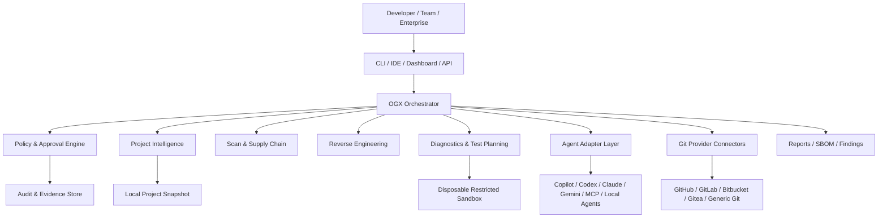

# OGX Universal Enterprise Master Blueprint v1.0

**Status:** architecture and engineering contract for the 0.4.0a1 foundation and subsequent releases. It does not claim that every target capability is implemented.

## 1. Mission

Build one extensible engine that can inventory, understand, review, secure, debug, test, govern and improve software projects across languages, frameworks, repository hosts and deployment models. Unknown stacks must degrade gracefully to generic analysis and a clear capability report instead of being treated as fully supported.

## 2. Product shape

- Local developer tool: CLI, PowerShell wrappers, IDE extensions and local dashboard.
- Repository service: local paths, generic Git and provider-specific APIs.
- Intelligence runtime: scanners, architecture analysis, diagnostics, SBOM and policy evaluation.
- Extension platform: skill manifests, agent adapters, tool adapters and plugin SDK.
- Enterprise management: organizations, members, projects, entitlements, usage, audit and deployment policy.
- Commercial distribution: Community, Professional, Team, Business, Enterprise, Self-hosted and SaaS editions.

## 3. Deployment topology

### Trust boundary rules

1. Repository contents, issue bodies, PR descriptions, web pages, logs, model output and plugins are untrusted data.
2. Agent text is never treated as permission or authority.
3. Local filesystem operations are restricted to explicitly selected project/workspace roots.
4. Network access is denied by default for sandboxed execution.
5. Provider tokens are provided through OS environment/credential managers and never written to project files or reports.
6. Remote writes require a distinct explicit confirmation and are auditable.
7. Target source is unchanged by default analysis.

## 4. Core module boundaries

| Package | Owns | Must not own |
|---|---|---|
| `core` | task lifecycle, IDs, events, orchestration contracts | provider-specific API logic |
| `detector` / `inventory` | language/manifest inventory and project profile | executing project code |
| `intelligence` | AST/symbol/architecture models | credentials or remote mutation |
| `scanner` / `security` | findings, rule catalog, evidence | automatic source edits |
| `sbom` / `licenses` | manifest-derived inventory | legal conclusion or unresolved version claims |
| `connectors` | Git and host API adapters | secret persistence |
| `agents` | agent discovery, protocol adapters, normalized results | permission bypass |
| `skills` / `plugins` | manifests, contracts, versioning | implicit code execution |
| `sandbox` | disposable project snapshot and restricted runner | mounting host secrets or Docker socket |
| `enterprise` | tenant-oriented domain model and audit | production identity without IdP integration |
| `reporting` | JSON, Markdown, SARIF, CycloneDX exports | copying raw secrets into findings |
| `recovery` | checkpoints, backups, rollback proofs | unreviewed destructive cleanup |

## 5. Project-type support strategy

Use a capability-based adapter registry rather than a binary `supported/unsupported` flag.

Each adapter declares:
- Project family and language versions.
- Manifest and lockfile parsers.
- Static syntax/AST support.
- Dependency resolver and vulnerability-data source.
- Test/build command discovery.
- Sandbox image/toolchain requirements.
- Reported confidence and known limitations.
- Adapter version and compatibility tests.

Initial detection targets include Python, JavaScript/TypeScript, Java/Kotlin, Go, Rust, PHP, Ruby, Swift, C/C++, C#/.NET, Dart/Flutter, Scala, Elixir, Erlang, Lua, Perl, R, Julia, Haskell, Solidity, Clojure, Crystal, SQL, Terraform and Protocol Buffers. Detection indicators are not equivalent to deep semantic analysis. Unknown/custom projects use generic inventory, text/security heuristics and user-installed adapters.

## 6. Scanner architecture

- Bounded filesystem walk; no following symlinks.
- Configurable excluded paths, file count, file size and total byte budgets.
- Hash-based incremental cache with cache poisoning/permission controls.
- Rule IDs stable across releases; rules declare severity, confidence, evidence type and remediation.
- Secret values are redacted at collection time, not only at report serialization.
- SARIF export and suppression files require signed/controlled policy in a later release.
- False-positive feedback is tracked with rule version and path identity.
- Full scan, changed-files scan, dependency-only scan and policy-only scan are separate modes.

## 7. Reverse engineering and debugging

Static import edges are explicitly distinguished from runtime call graphs. Advanced adapters may use language servers, compiler databases, ASTs, bytecode metadata, runtime traces or profiler output. Dynamic reflection, generated code, plugin loading and distributed traces require dedicated adapters.

A bug report must include: stable finding ID, minimal evidence, affected component, severity, confidence, reproduction status, suspected root cause, recommended test and proposed fix. A root-cause hypothesis is never mislabeled as confirmed.

## 8. Security and supply chain

- OSV/NVD/GHSA/provider advisory adapters must identify source, timestamp, package identity, affected version range and fixed version where available.
- CVE checks require a resolver and lockfile evidence. Manifest-only version constraints cannot prove installed versions.
- SBOM output distinguishes declared constraints from resolved versions and labels incomplete inventories.
- Secrets detection covers common token families, generic credential assignments and private-key headers; custom patterns must be configurable without exposing matches.
- SAST/DAST/container scanners should be integrated as pinned, locally installed adapters, not reimplemented as weak regex approximations.
- DAST and active probing are opt-in, scope-bound and disabled for third-party targets by default.
- Dependency installation scripts and package lifecycle hooks are not run outside approved sandbox workflows.

## 9. Agent orchestration

Agent Adapter SDK includes capability discovery, handshake, request/response schema, cancellation, timeouts, output limits, permission declaration, project context policy, audit correlation and result normalization. Providers may support different subsets (chat, code review, code edit, tools, structured output, MCP). OGX must disclose missing capabilities instead of pretending that all agents can do all operations.

Multi-agent review uses independent perspectives and a verifier pass. Consensus does not prove correctness; findings need source evidence and reproducibility.

## 10. Repair lifecycle

1. Baseline snapshot and clean/dirty Git status check.
2. Evidence-backed findings and candidate patches.
3. Human selection and explicit approval.
4. Patch applied only to a disposable workspace or a new feature branch.
5. Tests and static checks inside restricted sandbox.
6. Diff inspection, secret scan, license/dependency review and regression check.
7. User-approved commit/push/PR.
8. Rollback plan and report.

No auto-merge, deployment or production migration in default editions.

## 11. Git provider contracts

Provider adapter operations: identify remote, authenticate via supported environment/credential interface, inspect repository, list branches/PRs/issues, create branch, create draft PR/MR, read CI status and download supported artifacts. Mutating operations require explicit human confirmation and provider scopes limited to the target repository. Generic Git fallback provides clone/fetch/inspect/branch/push where Git is available; host-specific PR APIs are not assumed for generic hosts.

Current 0.4.0a1 supports Git CLI inspect, remote ls-remote, explicit clone, branch creation, feature-branch push, plus API repository metadata and draft PR/MR creation for supported providers. It does not yet implement a complete issue/CI/artifact lifecycle.

## 12. Enterprise domain model

Organization, User (external IdP subject), Membership, Project, License, UsageEvent, API Credential Hash and AuditEvent are organization-scoped. Every tenant resource query must include `organization_id`; authorization checks role membership before returning records. Secrets are never stored in the audit event payload. Production SaaS must use PostgreSQL or a managed relational database, schema migrations, tenant isolation tests, backup/restore tests, real OIDC/SAML, key management, rate limiting, abuse prevention, billing provider adapters, data residency and incident response.

0.4.0a1 has a local SQLite prototype/schema only. SQLite WAL supports local single-node development; it is not a production multi-tenant SaaS deployment architecture.

## 13. Commercial editions

- Community: local read-only scanning and basic reports.
- Professional: advanced local analysis, adapters and developer workflows.
- Team: shared organization projects, review workflow and team policies.
- Business: centralized governance, audit, CI integrations and support.
- Enterprise: SSO, RBAC, private adapters, compliance exports, self-hosted controls and SLAs.
- SaaS: managed control plane with per-tenant data isolation.
- Marketplace: signed official/third-party skills and plugins.

Edition checks are entitlement policy, not scattered UI flags. Licensing must fail safely, support offline grace policy only by documented terms, and allow customer data export/deletion.

## 14. Quality gates

- Unit tests for parsers, policy rules, connectors and serialization.
- Integration tests with local fake Git remotes and HTTP test servers.
- Property/fuzz tests for manifest parsing, path handling and untrusted data.
- Sandbox escape tests and resource exhaustion tests.
- Cross-platform install/build tests on Windows, Linux and macOS.
- Performance tests on 4 GB RAM baseline and large monorepos.
- Reproducible builds, signed wheels/archives, SBOM and provenance.
- Independent penetration testing before production claims.
- Compatibility certification per language/framework adapter.

## 15. Release acceptance criteria

A release cannot be called enterprise-ready unless: test matrix is green; release artifacts are signed and reproducible; all critical/high findings are triaged; provider scopes are least-privilege; tenant isolation is independently tested; backup/restore and disaster recovery are demonstrated; security response and support processes exist; and legal/commercial documents are reviewed.

## 16. 0.4.0a1 implemented foundation

Implemented in source:
- Existing 0.3.0 external engine and safe project-root integration.
- Multi-language project detection expanded with framework indicators.
- Bounded file inventory.
- Python import graph / JS relative import heuristic.
- Static security, secrets, dependency and Python syntax heuristics.
- Manifest-derived CycloneDX 1.5 SBOM inventory for selected ecosystems.
- License file/SPDX header inventory.
- Git remote detection, ls-remote, clone, branch creation and feature push.
- GitHub/GitLab/Bitbucket/Gitea API metadata and draft PR/MR adapter.
- Agent CLI presence discovery and capability declarations.
- Declarative official skill packs, manifest validation and schemas.
- Log diagnostics, heuristic debug triage, static import-based change-impact estimates, regression-test plans and remediation-plan reports.
- Restricted Docker snapshot runner; no unsandboxed fallback.
- Local tenant-oriented SQLite schema/store prototype and audit events.
- CLI, PowerShell helpers, tests and packaging.

## 17. Not completed in 0.4.0a1

Full live CVE intelligence, dependency resolution across every ecosystem, SAST/DAST/data-flow, full semantic code graphs, runtime distributed tracing, automatic root-cause proof, safe automated code repair, complete provider issue/CI APIs, production multi-tenant SaaS server, OIDC/SAML, PostgreSQL migrations, enterprise encryption/key management, signed marketplace packages, billing/entitlements server, dashboard/desktop UI, production monitoring, formal certifications and commercial legal clearance remain future milestones. These are not silently substituted with stubs or represented as implemented.

## 18. 0.7.0a1 governance increment

Implemented local-alpha additions:
- Six-pillar operating model metadata for Leadership, Direction, Management, Administration, Steering and Operations.
- Organization-scoped governance records for objectives, initiatives, risks, decisions, changes, incidents and service metrics.
- Audited governance record updates with an explicit status transition graph.
- Membership administration with owner/admin privilege boundaries and last-owner protection.
- Brevo transactional API and generic SMTP mail adapters; credentials are environment-provided only.
- One-time code email approvals (hashed at rest, expiry, failed-attempt lockout, four-eyes requester/approver separation, single-use execution claim and action allowlist).
- Email gate for file integration writes, safe repairs, Git fetch/clone/branch/push and Pull/Merge Request creation.

This remains local CLI/SQLite alpha. The configured external identity subjects are caller-supplied labels, not authenticated OIDC/SAML identities. The approval email is accepted by a mail provider, not proof of inbox delivery. No automatic merge, deployment, production database migration, generic shell execution or autonomous agent patch application is enabled by this increment.
