<a id="readme-top"></a>

<div align="center">

<a href="https://github.com/shajeduzzamanenan992008inc/OMEGA-GUARDIAN-X-Universal">
  
</a>

<p>
  
</p>

<h1>OMEGA GUARDIAN X &middot; Universal Enterprise Guardian</h1>

<p>
  <b>AI &nbsp;&middot;&nbsp; Engineering &nbsp;&middot;&nbsp; Security &nbsp;&middot;&nbsp; Governance &nbsp;&middot;&nbsp; Controlled Evolution</b><br>
  A local-first repository intelligence and enterprise governance toolkit.<br>
  Inspect repositories, understand engineering risk, and govern supported changes through human approval.
</p>

<p><sub><i>Built for controlled engineering. Human-governed. Evidence-driven.</i></sub></p>

<p>
  <a href="#architecture"><b>Architecture</b></a> &nbsp;&middot;&nbsp;
  <a href="#capabilities">Capabilities</a> &nbsp;&middot;&nbsp;
  <a href="#installation">Install</a> &nbsp;&middot;&nbsp;
  <a href="#first-run-usage">Quick Start</a> &nbsp;&middot;&nbsp;
  <a href="#email-gated-approvals">Approvals</a> &nbsp;&middot;&nbsp;
  <a href="#security-model-and-operating-safeguards">Security</a> &nbsp;&middot;&nbsp;
  <a href="#verification-and-build-evidence">Verification</a> &nbsp;&middot;&nbsp;
  <a href="#brand-assets-and-media-pack">Brand Kit</a>
</p>

[](#release-status)
[](#readiness-roadmap-and-known-limitations)
[](#requirements)
[](#what-omega-guardian-x-provides)
[](#installation)

[](https://github.com/shajeduzzamanenan992008inc/OMEGA-GUARDIAN-X-Universal/issues)
[](https://github.com/shajeduzzamanenan992008inc/OMEGA-GUARDIAN-X-Universal/commits/main)

<p>
  <a href="assets/banner/readme-banner-1600x500.png">Static banner</a> &nbsp;&middot;&nbsp;
  <a href="assets/banner/readme-banner-1600x500.mp4">MP4 animation</a> &nbsp;&middot;&nbsp;
  <a href="assets/banner/banner-800x400.gif">GIF fallback</a> &nbsp;&middot;&nbsp;
  <a href="assets/banner/social-preview-1280x640.jpg">GitHub social preview</a>
</p>

<p>
  
  
  
  
</p>

<p><sub>Brand badges above are decorative artwork from the supplied identity pack. They are not live system telemetry, verified CI indicators, or the software release number. The documented software release is <code>0.8.0a1</code>.</sub></p>

<p><b>Creator &amp; Builder:</b> <a href="https://github.com/shajeduzzamanenan992008inc">Shajeduzzaman Enan</a></p>

</div>

<p align="center"></p>

<details>
<summary><b>Table of contents</b></summary>

- [What OMEGA GUARDIAN X provides](#what-omega-guardian-x-provides)
- [Architecture](#architecture)
  - [Repository layout](#repository-layout)
  - [Canonical source and drop-in distribution](#canonical-source-and-drop-in-distribution)
  - [System topology flowchart](#system-topology-flowchart)
- [Capabilities](#capabilities)
  - [Repository audit and controlled-change flowchart](#repository-audit-and-controlled-change-flowchart)
- [Requirements](#requirements)
- [Installation](#installation)
- [First-run usage](#first-run-usage)
- [Private configuration](#private-configuration)
- [Enterprise governance](#enterprise-governance)
  - [Six governance pillars](#six-governance-pillars)
  - [Governance model flowchart](#governance-model-flowchart)
  - [Supported governance records](#supported-governance-records)
  - [Membership roles](#membership-roles)
- [Email-gated approvals](#email-gated-approvals)
  - [Intended lifecycle](#intended-lifecycle)
  - [Approval lifecycle flowchart](#approval-lifecycle-flowchart)
  - [Example workflow](#example-workflow)
- [Mail provider configuration](#mail-provider-configuration)
- [Security model and operating safeguards](#security-model-and-operating-safeguards)
- [Verification and build evidence](#verification-and-build-evidence)
  - [Verification flowchart](#verification-flowchart)
  - [Reported test results](#reported-test-results)
  - [Reported release artifacts](#reported-release-artifacts)
  - [Verification record requiring reconciliation](#verification-record-requiring-reconciliation)
  - [CI and compatibility status](#ci-and-compatibility-status)
- [Readiness roadmap and known limitations](#readiness-roadmap-and-known-limitations)
- [Project documentation](#project-documentation)
- [Development workflow](#development-workflow)
- [Brand assets and media pack](#brand-assets-and-media-pack)
- [Credits](#credits)
- [Release status](#release-status)

</details>


<p align="center"></p>
<p align="center"></p>

## What OMEGA GUARDIAN X provides

<p align="center"><i>Two coordinated parts: a reusable repository engineering kit and a local governance-aware CLI engine.</i></p>

OMEGA GUARDIAN X is organized around two complementary components:

| Component | Purpose | Distribution model |
|---|---|---|
| **`.github/` repository engineering kit** | Reusable specialist AI-agent instructions, secure CI templates, runbooks, issue and pull-request templates, Dependabot examples, and cross-stack development guidance | Repository-level files and templates |
| **`GUARDIAN-X/` local engine** | Repository audit, stack detection, syntax/security heuristics, architecture inventory, safe-repair preview, Git workflow, enterprise governance records, and email-gated approvals | Python package, `ogx` console script, and drop-in distribution |

### Operating principles

- **Local-first:** repository inspection and the CLI engine run in the user's local environment.
- **Human-governed changes:** supported write actions are approval-gated by default.
- **Read-only audits:** audit operations do not require email approval.
- **Clear source boundaries:** the packaged implementation and standard-library-only drop-in distribution are distinct trees with different responsibilities.
- **Evidence over assumptions:** test results, build provenance, and environmental limitations must be reported accurately.
- **No universal-repair claim:** syntax and security checks are heuristic; they cannot guarantee that arbitrary code is safe or correct.

<p align="center"></p>
<p align="center"></p>

## Architecture

<p align="center"><i>How the repository, canonical package, and drop-in runtime fit together.</i></p>

### Repository layout

```text
repository-root/
├── .github/
│   ├── instructions/             # Specialist AI-agent guidance
│   ├── workflows/                # Reusable CI workflow examples
│   ├── ISSUE_TEMPLATE/           # Issue templates
│   ├── PULL_REQUEST_TEMPLATE/    # Pull-request templates
│   └── ...                       # Runbooks and repository guidance
│
└── GUARDIAN-X/
    ├── src/ogx/                  # Canonical packaged implementation
    ├── core/ogx/                 # Drop-in standard-library-only runtime
    ├── tests/                    # Canonical pytest suite
    ├── _dev/
    │   ├── tests/                # Drop-in and distribution unittest suite
    │   └── tools/                # Development and consistency tools
    ├── docs/                     # Security, governance, and readiness docs
    ├── release/                  # Locally generated release artifacts
    ├── init.py                   # Drop-in entry point
    └── pyproject.toml            # Package and tool configuration
```

### Canonical source and drop-in distribution

The two runtime trees have different responsibilities and must not be treated as interchangeable copies.

| Area | Canonical package | Drop-in distribution |
|---|---|---|
| Source path | `GUARDIAN-X/src/ogx/` | `GUARDIAN-X/core/ogx/` |
| Purpose | Full packaged engine | Portable, standard-library-only runtime loaded by `GUARDIAN-X/init.py` |
| Packaging | Builds the `omega-guardian-x` wheel and installs the `ogx` console script | Distributed as a drop-in tree/archive |
| Internal layout | Package-oriented canonical implementation | Separately maintained internal layout |
| Provider engine | Included where supported by the packaged implementation | Not shipped in the drop-in tree |

**Implementation boundary:** feature implementation changes belong in `GUARDIAN-X/src/ogx/`. The drop-in tree is hand-maintained; do not assume that copying or synchronizing the canonical tree will generate equivalent feature code.

Run the consistency check from the repository root:

```powershell
python GUARDIAN-X/_dev/tools/sync_core_from_src.py --check
```

This check verifies version agreement, required packages and modules, absence of nested duplicate trees, name collisions, and packaging declarations. It is a validation tool; it does **not** generate, overwrite, or delete feature implementation code.

### System topology flowchart

The repository is split into a reusable GitHub engineering kit and a local Python engine. The two engine distributions have different responsibilities and must be validated independently.

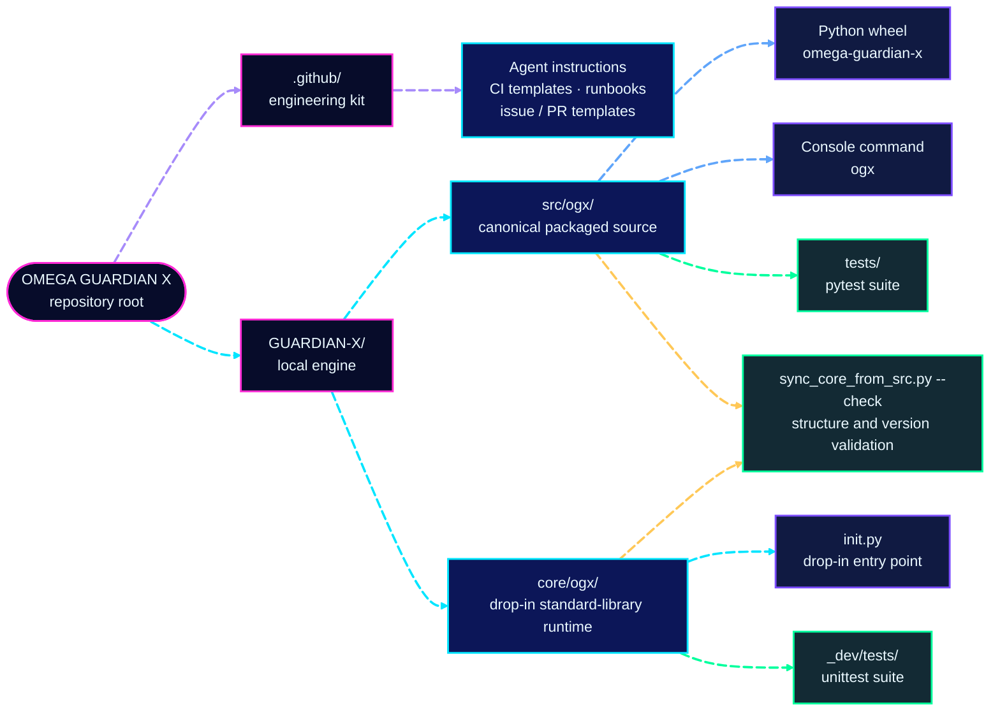

<p align="center"><sub><b>Diagram legend:</b> magenta = repository entry points · cyan = source/runtime components · violet = distribution outputs · green = validation surfaces. Dashed links indicate a consistency check, not automatic code generation.</sub></p>

<p align="center"><sub><b>Flow animation legend:</b> cyan / blue = primary system path &nbsp;·&nbsp; violet = distribution or approval &nbsp;·&nbsp; green = successful or validated path &nbsp;·&nbsp; amber = review / verification boundary &nbsp;·&nbsp; red = blocked or identity boundary. Every connection has an explicit Mermaid animation directive.</sub></p>

> [!NOTE]
> `sync_core_from_src.py --check` validates structure and declarations. It does not generate or synchronize feature implementation code from `src/ogx/` into `core/ogx/`.

## Capabilities

<p align="center"><i>Repository intelligence with explicit boundaries and human-governed write paths.</i></p>

The local engine brings together the following areas. Exact coverage of each scanner, repair, provider, and Git operation is implementation-dependent; consult command help and project documentation before using it on an important repository.

| Capability area | Intended role |
|---|---|
| Repository audit | Inspect a repository and report detected issues and engineering signals |
| Stack detection | Identify supported language and framework indicators |
| Syntax and security heuristics | Surface potential syntax, configuration, and security concerns for human review |
| Architecture inventory | Build an inventory of repository structure and architecture-related information |
| Safe-repair preview | Preview supported repair proposals before an approved write is executed |
| Git workflow | Support configured Git operations such as fetch, clone, branch, push, and draft PR/MR actions through the approval workflow |
| Enterprise governance | Store objectives, initiatives, risks, decisions, changes, incidents, and service metrics in the local data model |
| Email-gated approvals | Require an approver decision before supported write actions execute |
| Repository engineering kit | Provide reusable instructions, secure CI examples, templates, and operational guidance |

These capabilities do not imply support for every language, Git host, mail provider, repository layout, or enterprise identity system.

### Repository audit and controlled-change flowchart

The operating path begins with inspection. A write path is available only for supported actions and passes through validation and the configured approval gate.

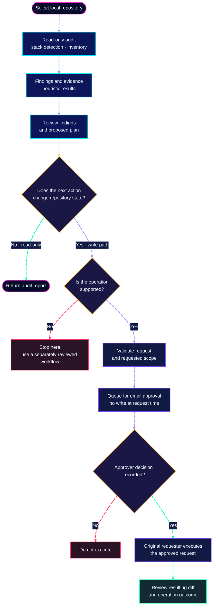

<p align="center"><sub>Read-only reports branch away before the write gate. The approval path applies to supported operations only; this diagram does not claim universal repair or universal write support.</sub></p>

<p align="center"></p>
<p align="center"></p>

## Requirements

<p align="center"><i>Declared runtime support and the external tools required by optional workflows.</i></p>

- **Python:** `3.11–3.13` is the declared compatibility range.
- **Operating system:** the supplied verification record includes Windows-specific execution. Platform-dependent tests may behave differently across operating systems.
- **Git:** required for Git workflow operations.
- **Mail provider:** Brevo transactional API or an SMTP-compatible relay is required for real email approval delivery.
- **Credentials:** optional integration credentials must be supplied through a private environment or secret manager, not committed to the repository.

> [!NOTE]
> The supplied local test record was produced with CPython `3.15.2` on Windows, which is outside the declared Python range. That run is useful evidence for that environment, but it does not establish compatibility with Python 3.11, 3.12, or 3.13. Those versions require verification in the supported CI matrix or equivalent local environments.

## Installation

<p align="center"><i>Install the local CLI, build a wheel, and start with a read-only audit.</i></p>

Run these commands in PowerShell from the repository root.

### Install from source

```powershell
cd GUARDIAN-X
python -m pip install .
ogx --version
```

### Build a wheel without installing it

```powershell
cd GUARDIAN-X
python -m pip wheel . --no-deps -w release
```

### Install a generated wheel

```powershell
cd GUARDIAN-X
python -m pip install .\release\omega_guardian_x-0.8.0a1-py3-none-any.whl
ogx --version
```

The wheel filename above is the filename recorded for release `0.8.0a1`; use the actual filename generated by your build if it differs.

### Run a repository audit

```powershell
ogx guardian audit "D:\Projects\MyProject"
```

Replace the example path with the repository you intend to inspect.

<p align="center"></p>
<p align="center"></p>

## First-run usage

<p align="center"><i>A practical sequence for initializing configuration and inspecting a repository.</i></p>

A recommended initial sequence is:

```powershell
# 1. Inspect the installed CLI and its version.
ogx --version
ogx --help

# 2. Initialize and locate private configuration.
ogx env init
ogx env path

# 3. After configuring required values, validate the environment.
ogx env check

# 4. Inspect the target repository without requesting a write.
ogx guardian audit "D:\Projects\MyProject"

# 5. Review the enterprise framework and initialize local governance data.
ogx enterprise framework
ogx enterprise init
```

Start with read-only inspection. Review proposed changes and understand the approval process before enabling integrations or write operations.

<p align="center"></p>

## Private configuration

<p align="center"><i>Keep credentials outside scanned projects and validate configuration before use.</i></p>

The Guardian CLI centralizes mail, email-approval, and optional Git-hosting credentials in a private `.env` file. By default, this file is stored outside scanned projects.

Use the CLI to initialize and locate the file:

```powershell
ogx env init
ogx env path
ogx env check
```

Edit the path reported by `ogx env path`, then run `ogx env check` again.

Configuration safeguards:

- Keep real `.env` files private and outside scanned repositories by default.
- `GUARDIAN-X/.env.example` contains placeholders only.
- Real `.env` files are Git-ignored according to the supplied project description; verify the ignore rules in your checkout.
- Never paste real credentials into issue reports, logs, commits, or AI-agent prompts.
- Prefer a managed secret store for shared or production environments.
- Rotate credentials immediately if they are exposed.

<p align="center"></p>

## Enterprise governance

<p align="center"><i>Six governance pillars backed by the currently supported local record model.</i></p>

The enterprise framework organizes governance into six control pillars and provides a local data model for governance records.

### Initialize an organization

```powershell
ogx enterprise framework
ogx enterprise init
ogx enterprise org-create --slug acme --name "Acme" --owner-subject "idp|owner"
```

The example uses placeholder organization and subject values. Replace them with values appropriate to your environment.

### Six governance pillars

| Pillar | Scope |
|---|---|
| **Leadership** | Accountability, delegation, risk appetite, and escalation |
| **Direction** | Mission, strategy, objectives, OKRs, and roadmap priorities |
| **Management** | Portfolio, capacity, delivery, budget/quality tracking, and benefits |
| **Administration** | Membership, roles, policy, audit evidence, and control records |
| **Steering** | Stage gates, assurance, decisions, risk acceptance, and corrective action |
| **Operations** | Change/incident handling, service metrics, reliability, and continuity |

### Governance model flowchart

The six pillars organize the local governance model. The model currently records the listed governance objects and membership roles; it is not a substitute for a real identity provider or production enterprise control plane.

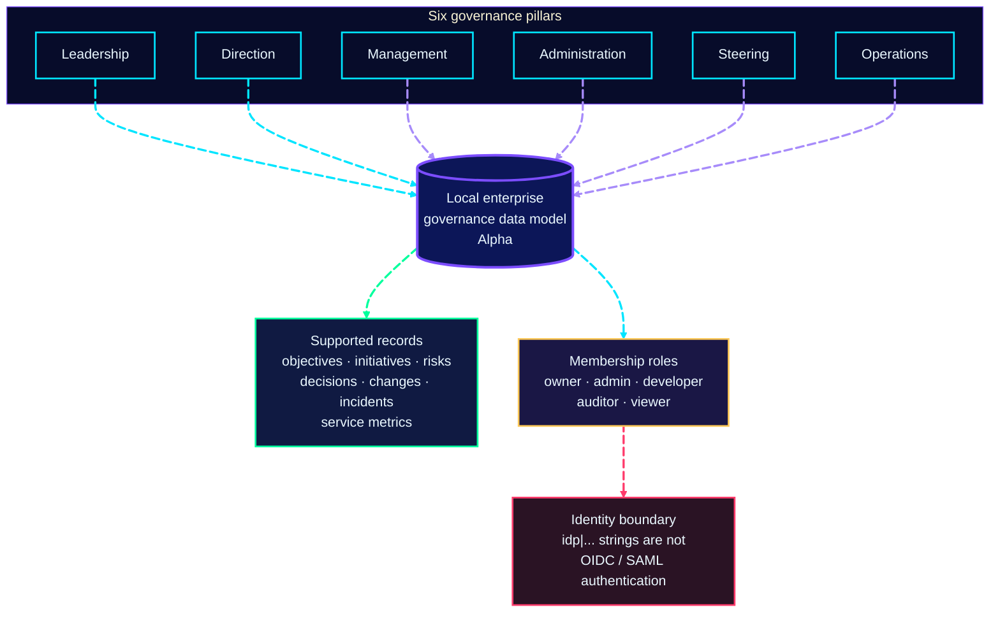

<p align="center"><sub>Cyan = governance pillars · violet = local governance model · green = supported record set · amber = membership roles · red = external identity limitation.</sub></p>

### Supported governance records

The current local data model supports:

- Objectives
- Initiatives
- Risks
- Decisions
- Changes
- Incidents
- Service metrics

### Membership roles

| Role | Role intent |
|---|---|
| `owner` | Organization ownership and top-level accountability |
| `admin` | Administrative governance responsibilities |
| `developer` | Engineering and delivery participation |
| `auditor` | Review and audit-oriented access |
| `viewer` | Read-oriented access |

The presence of a role or a subject string in the local data model does not by itself prove that a real identity has been authenticated or that production-grade authorization is enforced. See [Readiness roadmap and known limitations](#readiness-roadmap-and-known-limitations).

<p align="center"></p>

## Email-gated approvals

<p align="center"><i>A separate human approval step before supported write actions execute.</i></p>

Supported write actions are designed to require email approval by default. The request is queued; the write does not execute at request time.

### Intended lifecycle

1. The requester submits a supported action.
2. OMEGA GUARDIAN X validates the request and queues it for approval.
3. A one-time code is sent to the designated approver through the configured mail provider.
4. The approver records the decision from a trusted terminal.
5. The original requester executes the same validated request after approval.
6. The design intends to prevent the approved request from being executed more than once; verify the implementation and tests for the operation in use.

### Approval lifecycle flowchart

The mail provider delivers a one-time code to the designated approver. The approver records the decision, and the original requester executes the approved request from their own trusted terminal.

```mermaid
%%{init: {"theme": "base", "themeVariables": {"background": "#070C2A", "primaryColor": "#0C1658", "primaryTextColor": "#EAF8FF", "primaryBorderColor": "#00E5FF", "lineColor": "#7C4DFF", "secondaryColor": "#101A42", "tertiaryColor": "#070C2A", "clusterBkg": "#070C2A", "clusterBorder": "#7C4DFF", "edgeLabelBackground": "#101A42", "fontFamily": "Segoe UI, Arial, sans-serif"},"flowchart":{"curve":"basis","htmlLabels":true,"nodeSpacing":48,"rankSpacing":60}}}%%
flowchart TD
    REQUESTER["Original requester"] e01@--> CLI["ogx CLI<br/>supported write request"]
    CLI e02@--> VALIDATE["Validate request<br/>and arguments"]
    VALIDATE e03@--> QUEUE["Queue approval request<br/>write has not executed"]
    QUEUE e04@--> MAIL["Configured mail adapter<br/>Brevo API or SMTP relay"]
    MAIL e05@--> CODE["Deliver one-time code<br/>to designated approver"]
    CODE e06@--> APPROVER["Approver<br/>trusted terminal"]
    APPROVER e07@--> DECISION{"Approval decision?"}

    DECISION e08@-->|"Not approved"| HOLD["No write execution"]
    DECISION e09@-->|"Approved"| RECORD["Record approval<br/>ogx governance approve"]
    RECORD e10@--> ORIGINAL["Original requester<br/>ogx governance execute"]
    ORIGINAL e11@--> ACTION["Execute the same<br/>validated request once"]
    ACTION e12@--> REVIEW["Review resulting change<br/>and operation outcome"]

    classDef actor fill:#070C2A,stroke:#FF2BD6,stroke-width:2px,color:#EAF8FF
    classDef internal fill:#0C1658,stroke:#00E5FF,stroke-width:2px,color:#EAF8FF
    classDef external fill:#101A42,stroke:#7C4DFF,stroke-width:2px,color:#EAF8FF
    classDef decision fill:#1A1745,stroke:#FFC857,stroke-width:2px,color:#EAF8FF
    classDef blocked fill:#2A1324,stroke:#FF3B6B,stroke-width:2px,color:#EAF8FF
    classDef success fill:#132A34,stroke:#00FF9D,stroke-width:2px,color:#EAF8FF
    class REQUESTER,APPROVER actor
    class CLI,VALIDATE,QUEUE,RECORD,ORIGINAL,ACTION internal
    class MAIL,CODE external
    class DECISION decision
    class HOLD blocked
    class REVIEW success

    classDef flowCyan stroke:#00E5FF,stroke-width:2.5px,stroke-dasharray:9\,5
    classDef flowBlue stroke:#60A5FA,stroke-width:2.5px,stroke-dasharray:9\,5
    classDef flowViolet stroke:#A78BFA,stroke-width:2.5px,stroke-dasharray:8\,5
    classDef flowGreen stroke:#00FF9D,stroke-width:2.5px,stroke-dasharray:9\,5
    classDef flowAmber stroke:#FFC857,stroke-width:2.5px,stroke-dasharray:8\,5
    classDef flowRed stroke:#FF3B6B,stroke-width:2.5px,stroke-dasharray:7\,5

    class e01,e02 flowCyan
    class e03,e04 flowBlue
    class e05,e06,e07 flowViolet
    class e10,e11,e12 flowGreen
    class e08 flowAmber
    class e09 flowRed

    e01@{ animation: fast }
    e02@{ animation: fast }
    e03@{ animation: fast }
    e04@{ animation: fast }
    e05@{ animation: fast }
    e06@{ animation: fast }
    e07@{ animation: fast }
    e08@{ animation: slow }
    e09@{ animation: slow }
    e10@{ animation: fast }
    e11@{ animation: fast }
    e12@{ animation: fast }
```

> [!IMPORTANT]
> A queued request is not executed when it is submitted. Do not treat a delivered email or an approval decision as proof that the original requester has executed the operation successfully. The execution step is separate.

### Example workflow

```powershell
# Requester: prepare an integration plan.
ogx integrate plan "D:\Projects\MyProject"

# Requester: submit the supported change for approval.
ogx integrate apply "D:\Projects\MyProject" --confirm

# Approver, from a trusted terminal:
ogx governance approve <REQUEST_ID> --code <ONE_TIME_CODE>

# Original requester:
ogx governance execute <REQUEST_ID>
```

`<REQUEST_ID>` and `<ONE_TIME_CODE>` are placeholders; use the values produced by the actual request and email.

### Operations covered by the described approval policy

According to the supplied project description, the approval queue covers:

- Confirmed integration changes
- Supported safe repairs
- Git fetch and clone operations
- Git branch and push operations
- Draft pull-request and merge-request actions

Read-only audits do not require email approval. Confirm exact operation coverage against the current command implementation and policy configuration before use.

> [!WARNING]
> Do not enable `OGX_ALLOW_UNAPPROVED_WRITES=1` on a shared or production machine. Bypassing approval removes an important human-control boundary and should not be treated as a normal operating mode.

<p align="center"></p>

## Mail provider configuration

<p align="center"><i>Brevo transactional API or an SMTP-compatible relay.</i></p>

OMEGA GUARDIAN X documents two outbound approval-mail options: the Brevo transactional API and an SMTP-compatible mail relay.

### Option A — Brevo transactional API

Set the following values in the current PowerShell session or, preferably, through your secret manager:

```powershell
$env:OGX_MAIL_PROVIDER = "brevo"
$env:OGX_BREVO_API_KEY = "<Brevo API key>"
$env:OGX_MAIL_FROM_EMAIL = "verified-sender@example.com"
$env:OGX_APPROVER_EMAIL = "approver@example.com"
$env:OGX_APPROVER_SUBJECT = "idp|approver-subject"
$env:OGX_ACTOR_SUBJECT = "idp|requester-subject"
```

Use a verified sender address accepted by your Brevo account. Never commit the API key.

### Option B — SMTP-compatible provider

Use this adapter only when the mail service supplies standard SMTP relay credentials:

```powershell
$env:OGX_MAIL_PROVIDER = "smtp"
$env:OGX_SMTP_HOST = "<SMTP host>"
$env:OGX_SMTP_PORT = "587"
$env:OGX_SMTP_USERNAME = "<SMTP username>"
$env:OGX_SMTP_PASSWORD = "<SMTP password or SMTP key>"
$env:OGX_MAIL_FROM_EMAIL = "verified-sender@example.com"
$env:OGX_APPROVER_EMAIL = "approver@example.com"
$env:OGX_APPROVER_SUBJECT = "idp|approver-subject"
$env:OGX_ACTOR_SUBJECT = "idp|requester-subject"
```

Do not assume that a Brevo API key can authenticate against another provider's SMTP service or API. A distinct provider requires its own documented adapter and credentials.

### Important provider distinction

The supplied project notes distinguish **Brevo** from **Bravo AI** at `bravo.ai`. Those notes state that Bravo AI's connected Gmail/Outlook access is read-only and cannot send or edit email. If that is the product being considered, it cannot serve as the outbound approval sender described here. Use Brevo or another provider that explicitly supports outbound SMTP/API sending. A separate Bravo-branded mail service should only be used through SMTP if it documents SMTP relay support; otherwise, it needs a dedicated API adapter.

### Delivery verification

The supplied verification notes report mocked HTTP and SMTP client tests, but do not report a successful real-inbox delivery test. Before depending on approvals operationally, verify sender authentication, delivery, spam handling, one-time-code expiry, approver identity, and failure behavior in a controlled environment.

<p align="center"></p>

## Security model and operating safeguards

<p align="center"><i>Treat findings as signals, keep humans in control, and preserve trust boundaries.</i></p>

OMEGA GUARDIAN X is intended to support safer repository operations, but its safeguards do not replace independent security controls.

### Recommended operating rules

1. Begin with read-only audits and review the findings.
2. Inspect every proposed repair or integration change before approval.
3. Keep approval credentials and one-time codes private.
4. Use a separate trusted terminal for approver actions.
5. Keep secrets out of repositories, test fixtures, logs, and documentation.
6. Do not use approval bypasses on shared or production systems.
7. Review generated Git changes before pushing or opening a PR/MR.
8. Back up important repositories and governance data before high-impact operations.
9. Treat heuristic findings as signals for investigation, not proof of exploitability or safety.
10. Require human review for changes that affect production, security boundaries, data handling, or deployment.

### Security and trust boundaries

- The project is local-first and alpha-stage; do not assume that it provides hosted multi-tenant isolation.
- The `idp|...` subject strings in the current local data model are not authenticated against a real OIDC or SAML identity provider, according to the supplied readiness notes.
- A queued approval workflow is not equivalent to enterprise SSO, hardware-backed approval, or an independently verified identity system.
- A successful static or heuristic scan cannot prove that a repository is secure.
- A repair preview is not a guarantee that the resulting change is correct, complete, or safe in every runtime environment.

<p align="center"></p>
<p align="center"></p>

## Verification and build evidence

<p align="center"><i>Reported local results, artifact evidence, and the gaps that remain open.</i></p>

The figures below are transcribed from the supplied project verification notes. They are **reported local results**, not a claim that this README or the currently checked-out repository has independently rerun every command.

### Reported test results

| Area | Reported command | Reported result |
|---|---|---|
| Canonical source | `python -m pytest -q` | **631 passed, 18 skipped, 119 subtests passed** |
| Drop-in distribution | `PYTHONPATH=core python -m unittest discover -s _dev/tests` | **289 tests, OK (9 skipped)** |
| Architecture/distribution checks | Included in the reported suites | **17 passed** |
| Compilation | `python -m compileall -q src core tests _dev/tests` | **Passed** |

The supplied notes give the canonical test run as Windows/CPython `3.15.2`, on `2026-11-27`, on an implementation branch based on `71fcbbc`, taking `151.71 s` with exit code `0`. The drop-in suite is reported as taking `92.36 s`, with exit code `0`, on `2026-11-27`.

### Reported release artifacts

| Artifact | Evidence in supplied notes | Qualification |
|---|---|---|
| Wheel `omega_guardian_x-0.8.0a1-py3-none-any.whl` | Rebuilt `2026-11-27`; SHA-256 begins `9710fbd6`; 140 files; 422,662 bytes | Clean-venv installation was last verified against an earlier wheel from `36e56c0`, not repeated for this rebuilt wheel |
| Drop-in ZIP | 326 files; SHA-256 begins `a65a2c80`; clean export reported on `2026-11-26` | Notes refer to a `36e56c0` export and also an `a004348` execution baseline |
| Distribution exclusions | Forbidden-path assertion reported 0 hits; required runtime entries present; deterministic ordering regression-tested | Based on supplied distribution-test and export notes |

The wheel is reported to contain the new patch, orchestrator, and GitHub-host modules, with no test, CI, or source-tree leakage. The wheel build also warned that the declared `LICENSE` file was absent, so no license file was bundled.

### Verification record requiring reconciliation

The supplied text contains conflicting execution metadata: one statement says the latest figures were run on `2026-11-27` on a branch based on `71fcbbc`; another says every figure in the section was re-executed on `2026-11-26` at HEAD `7135b6e`. Those are not the same execution date or baseline. The reported counts are retained, but the records should not be silently merged. Before publishing a release, record one reproducible verification run with its exact commit SHA, timestamp, OS, Python version, command output, and artifact hashes.

### CI and compatibility status

- Hosted GitHub Actions has **not** produced a verified run in the supplied notes. The last observed push-triggered runs were refused before any job started because of account billing/spending limits; see `GUARDIAN-X/docs/CI_FAILURE_ROOT_CAUSE_REPORT.md`.
- Python `3.11`, `3.12`, and `3.13` were not available locally in the reported environment. The declared-version matrix remains unverified by those local runs.
- The canonical suite reports 18 skipped tests; the supplied notes identify 17 as Windows-related (15 symlink and 2 POSIX file-mode tests), without characterizing the remaining skip. The drop-in suite reports 9 skips. The notes characterize platform-gated tests as covered by the Linux CI matrix, but hosted CI has not produced a verified run.
- Brevo and SMTP transports were tested with mocked HTTP/SMTP clients; no real inbox delivery was reported.
- Clean-virtual-environment installation of the latest reported wheel was not repeated.

> [!CAUTION]
> A local passing test suite does not establish that hosted CI is healthy, that every declared Python version is supported, that a real email will be delivered, or that the generated wheel installs correctly in a clean environment. Verify each release criterion independently.

### Verification flowchart

This map separates reported local checks and build outputs from release evidence that remains unverified in the supplied record.

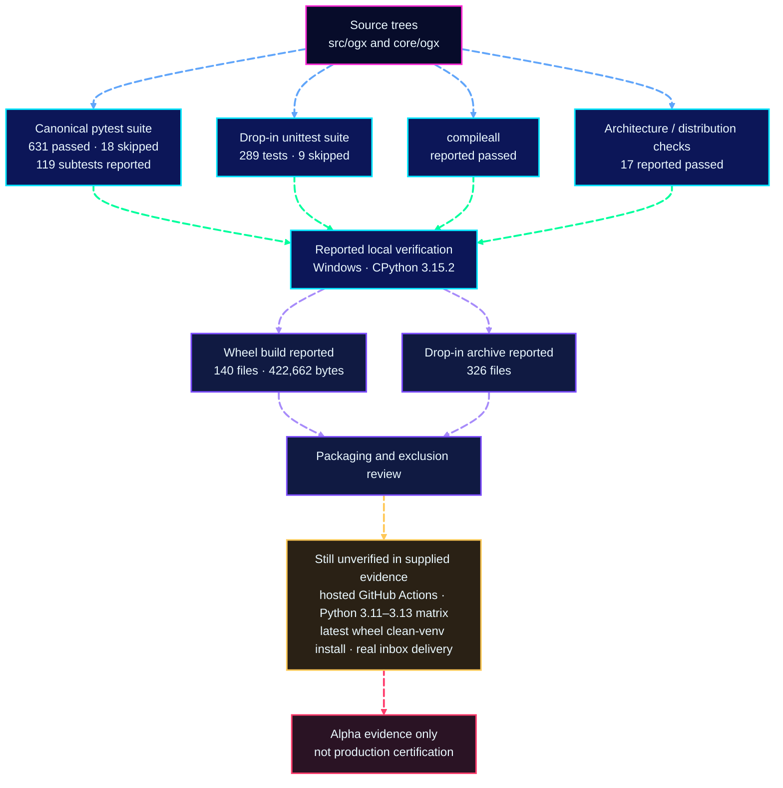

<p align="center"><sub>Cyan = reported local checks · violet = generated artifacts and packaging review · amber = evidence gaps · red = release limitation. Counts are reproduced from the supplied verification notes, not newly rerun in this README-editing step.</sub></p>

## Readiness roadmap and known limitations

<p align="center"><i>The work required before considering production enterprise adoption.</i></p>

This is a readiness checklist derived from the supplied limitations, not a dated delivery promise or a claim that the items are already implemented.

| Area | Current limitation or required work |
|---|---|
| Product maturity | Alpha; not a certified compliance product or production SaaS service |
| Identity | `idp|...` subject strings are not authenticated against a real OIDC/SAML identity provider |
| Data layer | Production use requires a managed database and migration strategy |
| Secret management | Production use requires KMS-backed secrets and a rotation process |
| Tenant isolation | Production use requires explicit tenant-isolation controls |
| Audit evidence | Production use requires immutable, centralized audit records |
| Operations | Production use requires monitoring, alerting, and operational ownership |
| Resilience | Production use requires tested backups and disaster-recovery procedures |
| Abuse protection | Production use requires controls against abuse and unauthorized request patterns |
| Assurance | Production use requires an independent security review |
| Python matrix | Declared Python versions `3.11–3.13` need verified matrix results |
| Hosted CI | A successful GitHub Actions run has not been established in the supplied evidence |
| Mail delivery | Real inbox delivery has not been established in the supplied evidence |
| Wheel validation | Clean-virtual-environment installation of the latest reported wheel was not repeated |
| Licensing | The build reported that `LICENSE` was absent; add and verify the intended license before distribution |

Do not describe these controls as implemented until the relevant implementation, tests, operational evidence, and documentation exist.

<p align="center"></p>

## Project documentation

<p align="center"><i>The detailed security, governance, readiness, and CI reports.</i></p>

Read the following documents before enabling write operations or evaluating the project for enterprise use:

- [`GUARDIAN-X/docs/ENTERPRISE_GOVERNANCE_AND_APPROVALS.md`](GUARDIAN-X/docs/ENTERPRISE_GOVERNANCE_AND_APPROVALS.md) — governance framework and approval lifecycle.
- [`GUARDIAN-X/docs/SECURITY_MODEL.md`](GUARDIAN-X/docs/SECURITY_MODEL.md) — security assumptions, boundaries, and controls.
- [`GUARDIAN-X/docs/ENTERPRISE_READINESS.md`](GUARDIAN-X/docs/ENTERPRISE_READINESS.md) — enterprise readiness considerations and remaining requirements.
- [`GUARDIAN-X/docs/CI_FAILURE_ROOT_CAUSE_REPORT.md`](GUARDIAN-X/docs/CI_FAILURE_ROOT_CAUSE_REPORT.md) — reported GitHub Actions billing/spending blocker.

These repository-relative paths assume that the documented files exist in the checkout.

<p align="center"></p>

## Development workflow

<p align="center"><i>Test both runtime surfaces and check distribution boundaries before release.</i></p>

### Run the canonical test suite

```powershell
cd GUARDIAN-X
python -m pytest -q
```

### Run the drop-in and distribution test suite

```powershell
cd GUARDIAN-X
$env:PYTHONPATH = "core"
python -m unittest discover -s _dev/tests
Remove-Item Env:PYTHONPATH
```

### Compile source, runtime, and tests

```powershell
cd GUARDIAN-X
python -m compileall -q src core tests _dev/tests
```

### Check canonical/drop-in structural consistency

```powershell
cd GUARDIAN-X
python _dev/tools/sync_core_from_src.py --check
```

### Before submitting a change

- Keep canonical implementation changes in `src/ogx/`.
- Update the separately maintained drop-in runtime only when the feature is intended and supported there.
- Add or update tests for both distributions where applicable.
- Run the relevant test suites and consistency checks.
- Review packaging contents to prevent tests, CI files, local secrets, or development metadata from entering release artifacts.
- Update the relevant security, governance, or user documentation.
- Record the exact commit, environment, commands, results, and artifact hashes for release verification.
- Do not report an unexecuted test, unverified CI run, or mocked provider test as a production validation result.

<p align="center"></p>
<p align="center"></p>

<p align="center"></p>

## Brand assets and media pack

<p align="center"><i>The supplied Omega identity, README kit, static fallbacks, and social preview.</i></p>

The supplied `assets.zip` contains the complete visual identity package. The paths below are relative to the repository root and are preserved in this README pack. See [`assets/README.md`](assets/README.md) for the asset-pack usage guide and [`ASSET-MANIFEST.json`](ASSET-MANIFEST.json) for the packaged-file inventory and SHA-256 hashes.

### Banner and social media assets

| Asset | Use |
|---|---|
| [`assets/banner/readme-banner-1600x500.svg`](assets/banner/readme-banner-1600x500.svg) | Wide animated README hero banner used at the top of this file |
| [`assets/banner/readme-banner-1600x500.png`](assets/banner/readme-banner-1600x500.png) | Static fallback for the wide README banner |
| [`assets/banner/readme-banner-1600x500.mp4`](assets/banner/readme-banner-1600x500.mp4) | Video version of the wide banner; linked rather than embedded for README portability |
| [`assets/banner/banner-1280x640.svg`](assets/banner/banner-1280x640.svg) | Animated 1280×640 banner variant |
| [`assets/banner/banner-1280x640.png`](assets/banner/banner-1280x640.png) | Static 1280×640 banner variant |
| [`assets/banner/banner-1280x640.mp4`](assets/banner/banner-1280x640.mp4) | Video 1280×640 banner variant |
| [`assets/banner/banner-800x400.gif`](assets/banner/banner-800x400.gif) | Animated GIF fallback |
| [`assets/banner/social-preview-1280x640.jpg`](assets/banner/social-preview-1280x640.jpg) | GitHub social preview image; upload through repository Settings → Social preview |

### Logo and application icons

| Asset | Use |
|---|---|
| [`assets/logo/omega-logo.svg`](assets/logo/omega-logo.svg) | Animated transparent Omega logo, displayed prominently beneath the README hero banner |
| [`assets/logo/omega-logo-1024.png`](assets/logo/omega-logo-1024.png) | Transparent 1024×1024 logo image |
| [`assets/logo/omega-logo-bg.svg`](assets/logo/omega-logo-bg.svg) | Animated logo with background |
| [`assets/logo/omega-logo-bg-1024.png`](assets/logo/omega-logo-bg-1024.png) | Static logo with background |
| [`assets/logo/omega-logo-bg-768.mp4`](assets/logo/omega-logo-bg-768.mp4) | Video logo-background variant |
| [`assets/logo/omega-icon.svg`](assets/logo/omega-icon.svg) | Vector application icon |
| [`assets/logo/omega-icon.ico`](assets/logo/omega-icon.ico) | Windows icon file |
| [`omega-icon-32.png`](assets/logo/omega-icon-32.png) · [`64`](assets/logo/omega-icon-64.png) · [`128`](assets/logo/omega-icon-128.png) · [`180`](assets/logo/omega-icon-180.png) · [`192`](assets/logo/omega-icon-192.png) · [`256`](assets/logo/omega-icon-256.png) · [`512`](assets/logo/omega-icon-512.png) | PNG icon sizes for applications, browser icons, and device manifests |

<p align="center">
  
</p>

### README design kit

| Resource | Purpose |
|---|---|
| `assets/readme-kit/badge-1.svg` | GUARDIAN-X / ACTIVE visual badge |
| `assets/readme-kit/badge-2.svg` | SELF EVOLUTION / ON visual badge |
| `assets/readme-kit/badge-3.svg` | NEXUS PRIME / SYNCED visual badge |
| `assets/readme-kit/badge-4.svg` | UNIVERSAL / V1.0 visual badge; artwork only, not the software release version |
| `assets/readme-kit/divider.svg` | Animated section divider used throughout this README |
| `assets/readme-kit/png/divider.png` | Static divider fallback |
| `assets/readme-kit/section-features.svg` | Features section header |
| `assets/readme-kit/section-architecture.svg` | Architecture section header |
| `assets/readme-kit/section-installation.svg` | Installation section header |
| `assets/readme-kit/section-usage.svg` | Usage section header |
| `assets/readme-kit/section-roadmap.svg` | Readiness and roadmap section header |
| `assets/readme-kit/section-credits.svg` | Credits section header |
| `assets/readme-kit/footer.svg` | Animated creator/footer artwork |
| `assets/readme-kit/png/footer.png` | Static footer fallback |
| `assets/readme-kit/README-snippet.md` | Corrected README asset snippet with repository-root paths |

### Animation and compatibility notes

- The brand-pack notes state that the animated loops are designed for an 8.5-second seamless loop.
- SVG animation is used where supported by the viewing platform. The PNG and GIF alternatives are provided for static or animated fallback use.
- MP4 files are retained in the asset pack and linked for direct viewing; they are not embedded as autoplay videos in this Markdown README.
- The brand-pack notes state that text in the SVG artwork is outlined, so external font installation is not required to render the supplied SVGs. The listed outline-font families are Montserrat and Anonymous Pro, both described by the pack as OFL.
- Keep the directory structure intact. The README references the exact `assets/...` paths; moving files or flattening folders will break the images.

## Credits

<p align="center"><i>Project authorship and visual identity acknowledgement.</i></p>

<p align="center">
  
</p>

**Creator & Builder:** Shajeduzzaman Enan  
**Project:** OMEGA GUARDIAN-X Universal  
**Repository:** [OMEGA-GUARDIAN-X-Universal](https://github.com/shajeduzzamanenan992008inc/OMEGA-GUARDIAN-X-Universal)

<p align="center">
  <a href="assets/readme-kit/png/footer.png">Static footer fallback</a> ·
  <a href="assets/readme-kit/png/divider.png">Static divider fallback</a> ·
  <a href="assets/logo/omega-icon.svg">Vector Omega icon</a>
</p>

<p align="center"><sub>OMEGA GUARDIAN-X UNIVERSAL · AI · ENGINEERING · SECURITY · GOVERNANCE · EVOLUTION</sub></p>

<div align="center">

<sub>Built with precision by <b>Shajeduzzaman Enan</b>.</sub>

<a href="#readme-top"><b>↑ Back to top</b></a>

</div>

---

<a id="release-status"></a>

**Release status:** `0.8.0a1` · **Alpha**

OMEGA GUARDIAN X is an evolving repository governance and local engineering toolkit. Use it with human review, least privilege, private credential handling, and a clear understanding of the limitations above. Production enterprise adoption should wait until identity, tenant isolation, managed data, immutable audit, secret management, operational resilience, CI compatibility, and independent security assurance have been implemented and verified.
